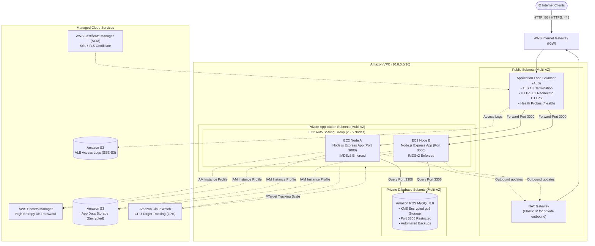

# Savitara Infotel – DevOps Practical Assessment
### Production-Grade AWS Infrastructure as Code (Terraform) & CI/CD Pipeline

[](https://github.com/candidate-username/savitara-devops-assignment/actions)
[](https://www.terraform.io/)
[](https://aws.amazon.com/)
[](https://nodejs.org/)
[](LICENSE)

---

## 📌 Executive Summary

This repository contains the complete implementation for the **Savitara Infotel DevOps Engineer Technical Assessment**.

The infrastructure is provisioned completely via **Terraform (Infrastructure as Code)** following enterprise AWS Well-Architected Framework principles, high availability (Multi-AZ), least-privilege security, automated secrets management, encrypted storage, and automated GitHub Actions CI/CD.

---

## 🏛️ Architecture Overview

The application is deployed across **two Availability Zones** in the `ap-south-1` (Mumbai) region for fault tolerance and zero downtime.



---

## 🎯 Scope & Deliverables Checklist

| Category | Requirement | Implementation Status | Evidence / Location |
|---|---|:---:|---|
| **Networking** | Multi-AZ VPC, Public & Private Subnets | ✅ Completed | [`terraform/modules/vpc`](file:///c:/Users/USER/Desktop/Savitara%20Infotel%20DevOps%20Practical%20Assignment/savitara-devops-assignment/terraform/modules/vpc) |
| **Networking** | Route Tables, Internet Gateway, NAT Gateway | ✅ Completed | Isolated route tables per tier |
| **Compute** | EC2 Auto Scaling Group with Launch Template | ✅ Completed | [`terraform/modules/asg`](file:///c:/Users/USER/Desktop/Savitara%20Infotel%20DevOps%20Practical%20Assignment/savitara-devops-assignment/terraform/modules/asg) |
| **Load Balancing** | ALB with HTTPS (ACM) & HTTP->HTTPS Redirect | ✅ Completed | [`terraform/modules/alb`](file:///c:/Users/USER/Desktop/Savitara%20Infotel%20DevOps%20Practical%20Assignment/savitara-devops-assignment/terraform/modules/alb) |
| **Database** | RDS MySQL deployed in private subnets | ✅ Completed | [`terraform/modules/rds`](file:///c:/Users/USER/Desktop/Savitara%20Infotel%20DevOps%20Practical%20Assignment/savitara-devops-assignment/terraform/modules/rds) |
| **Secrets** | AWS Secrets Manager for database credentials | ✅ Completed | [`terraform/modules/secrets_manager`](file:///c:/Users/USER/Desktop/Savitara%20Infotel%20DevOps%20Practical%20Assignment/savitara-devops-assignment/terraform/modules/secrets_manager) |
| **Security** | Least-privilege IAM Roles & Chained Security Groups | ✅ Completed | [`terraform/modules/iam`](file:///c:/Users/USER/Desktop/Savitara%20Infotel%20DevOps%20Practical%20Assignment/savitara-devops-assignment/terraform/modules/iam), [`terraform/modules/security_groups`](file:///c:/Users/USER/Desktop/Savitara%20Infotel%20DevOps%20Practical%20Assignment/savitara-devops-assignment/terraform/modules/security_groups) |
| **Storage** | S3 for App Data & S3 for ALB Access Logs | ✅ Completed | [`terraform/modules/s3`](file:///c:/Users/USER/Desktop/Savitara%20Infotel%20DevOps%20Practical%20Assignment/savitara-devops-assignment/terraform/modules/s3) |
| **CI/CD** | GitHub Actions Pipeline (Test, Plan, Apply, Verify) | ✅ Completed | [`.github/workflows/terraform-ci-cd.yml`](file:///c:/Users/USER/Desktop/Savitara%20Infotel%20DevOps%20Practical%20Assignment/savitara-devops-assignment/.github/workflows/terraform-ci-cd.yml) |
| **Application** | Node.js REST API with `/health` and MySQL checks | ✅ Completed | [`app/server.js`](file:///c:/Users/USER/Desktop/Savitara%20Infotel%20DevOps%20Practical%20Assignment/savitara-devops-assignment/app/server.js) |
| **Documentation** | Architecture diagram, Security matrix, Runbook | ✅ Completed | [`docs/`](file:///c:/Users/USER/Desktop/Savitara%20Infotel%20DevOps%20Practical%20Assignment/savitara-devops-assignment/docs) |

---

## 🔒 Security & Best Practices Highlights

1. **Zero Hardcoded Credentials**:
   - The MySQL database master password is generated with 24 high-entropy random characters and pushed directly into **AWS Secrets Manager**.
   - The application dynamically retrieves the secret using the AWS SDK v3 via the **EC2 IAM Instance Profile** (`secretsmanager:GetSecretValue`).

2. **Chained Defense-in-Depth Security Groups**:
   - **ALB SG**: Allows 80/443 from `0.0.0.0/0`.
   - **EC2 SG**: Inbound TCP port 3000 permitted **only** from the ALB Security Group ID. No public IP assigned.
   - **RDS SG**: Inbound TCP port 3306 permitted **only** from the EC2 Security Group ID. Zero public access.

3. **HTTPS & Encryption Everywhere**:
   - Port 80 on ALB automatically issues `HTTP 301 Moved Permanently` to port 443 (HTTPS).
   - ALB uses modern TLS 1.3 / 1.2 security policy (`ELBSecurityPolicy-TLS13-1-2-2021-06`).
   - S3 buckets enforce default `AES256` Server-Side Encryption and S3 Public Access Block.
   - RDS MySQL utilizes KMS-managed block storage encryption (`storage_encrypted = true`).
   - EC2 Launch Template strictly enforces **IMDSv2** (`http_tokens = "required"`, hop limit 1) to guard against SSRF attacks.

4. **Zero Open SSH Ports**:
   - EC2 instances do not expose port 22. Secure administration is handled through **AWS Systems Manager (SSM) Session Manager** via IAM policy `AmazonSSMManagedInstanceCore`.

---

## 🚀 Quick Deployment Guide

### Local Terraform Deployment

```bash
# 1. Clone repository
git clone https://github.com/<your-username>/savitara-devops-assignment.git
cd savitara-devops-assignment/terraform

# 2. Configure variables
cp terraform.tfvars.example terraform.tfvars

# 3. Initialize & validate
terraform init
terraform fmt -check -recursive
terraform validate

# 4. Review plan
terraform plan

# 5. Apply infrastructure
terraform apply -auto-approve
```

### End-to-End Verification

```bash
# 1. Verify HTTP -> HTTPS 301 Redirect
curl -I http://<ALB_DNS_NAME>

# 2. Verify Application Health
curl -k https://<ALB_DNS_NAME>/health

# 3. Verify Database Query
curl -k https://<ALB_DNS_NAME>/api/db-status

# 4. Verify S3 Read/Write
curl -k https://<ALB_DNS_NAME>/api/s3-test
```

### Teardown & Resource Cleanup

```bash
terraform destroy -auto-approve
```

---

## 📁 Repository Structure

```
.
├── .github/
│   └── workflows/
│       └── terraform-ci-cd.yml      # CI/CD workflow (Lint, Test, Plan, Apply, Smoke Test)
├── app/
│   ├── package.json                 # Express, AWS SDK, MySQL2
│   ├── server.js                    # Core web service & health endpoints
│   ├── app.test.js                  # Unit test suite
│   ├── Dockerfile                   # Multi-stage container file
│   └── app.service                  # Linux systemd service unit
├── terraform/
│   ├── main.tf                      # Root composition of 8 modular layers
│   ├── variables.tf                 # Configurable parameters
│   ├── outputs.tf                   # ALB URL, Health URL, RDS endpoint
│   ├── versions.tf                  # Provider constraints
│   ├── terraform.tfvars.example     # Sample variables
│   └── modules/
│       ├── vpc/                     # Multi-AZ networking, subnets, IGW, NAT GW
│       ├── security_groups/         # ALB, EC2, and RDS security groups
│       ├── secrets_manager/         # Random password and Secrets Manager vault
│       ├── s3/                      # App storage and ALB access logs buckets
│       ├── iam/                     # EC2 IAM role and least-privilege policies
│       ├── rds/                     # Multi-AZ private MySQL RDS instance
│       ├── alb/                     # ALB, ACM certificate, HTTP-to-HTTPS redirect
│       └── asg/                     # Launch template, user-data script, ASG target tracking
├── docs/
│   ├── architecture-diagram.md      # Detailed architecture flow & Mermaid diagrams
│   ├── deployment-guide.md          # Comprehensive operations & troubleshooting runbook
│   ├── security-matrix.md           # Network, IAM, and Security Group matrix
│   └── screenshots/                 # Deployment verification guide & placeholders
└── README.md
```

---

## 👨‍💻 Candidate Details (Submission Form)

- **Total Experience:** 3.5 Years
- **Relevant Experience (DevOps / AWS / IaC / CI/CD):** 3.5 Years
- **Current Company:** [Current Employer / Candidate to fill]
- **Current Designation:** DevOps Engineer
- **Current Salary (CTC):** [Candidate to fill]
- **Expected Salary (CTC):** [Candidate to fill]
- **Notice Period:** Immediate / 15-30 Days
- **Current Location:** [Candidate to fill]
- **Ready to Relocate to Ahmedabad?:** Yes
