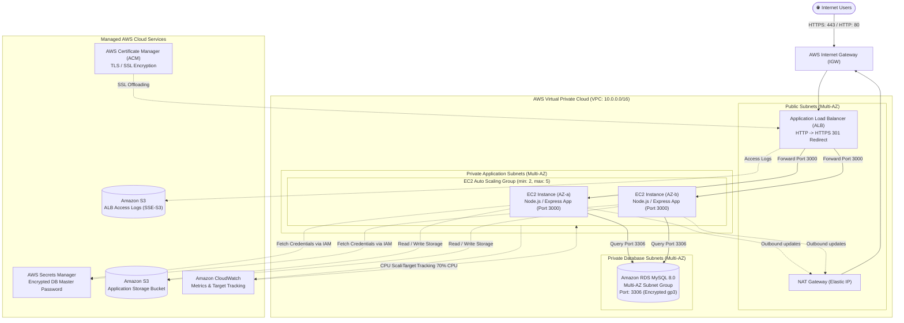

# AWS Infrastructure Architecture Diagram

This document provides visual diagrams and architectural flow specifications for the **Savitara Infotel DevOps Assessment** infrastructure.

## High-Level Architecture Flow

---

## Detailed Traffic and Security Flow

1. **Inbound Web Traffic**:
   - Clients send web requests to `https://<alb-dns-name>`.
   - If a client attempts `http://<alb-dns-name>` on Port 80, the ALB listener issues an immediate HTTP `301 Moved Permanently` redirect to HTTPS (Port 443).
   - The ALB terminates SSL/TLS using the AWS Certificate Manager (ACM) certificate.
   - The ALB validates target instance health via `/health` HTTP probe.

2. **Application Tier (EC2 Auto Scaling Group)**:
   - EC2 instances are hosted in strictly private subnets (`10.0.11.0/24`, `10.0.12.0/24`) with zero public IP addresses.
   - Instances only accept inbound traffic from the ALB's Security Group on TCP port 3000.
   - Outbound traffic to the internet (for package installation, OS updates, and AWS API calls) is routed through the NAT Gateway located in the public subnet.

3. **Database Tier (Amazon RDS MySQL)**:
   - MySQL 8.0 is deployed in isolated database private subnets (`10.0.21.0/24`, `10.0.22.0/24`).
   - The RDS Security Group strictly allows TCP port 3306 inbound only from the EC2 Application Security Group.
   - Storage is encrypted at rest using AWS KMS AES-256.

4. **Credential Security**:
   - The database master password is generated with 24 characters of high entropy and stored directly in AWS Secrets Manager.
   - The EC2 instances assume an IAM role granting least-privilege `secretsmanager:GetSecretValue` access to load credentials into memory dynamically at runtime.
   - No passwords or secrets are ever hardcoded in code, Terraform files, or version control.

